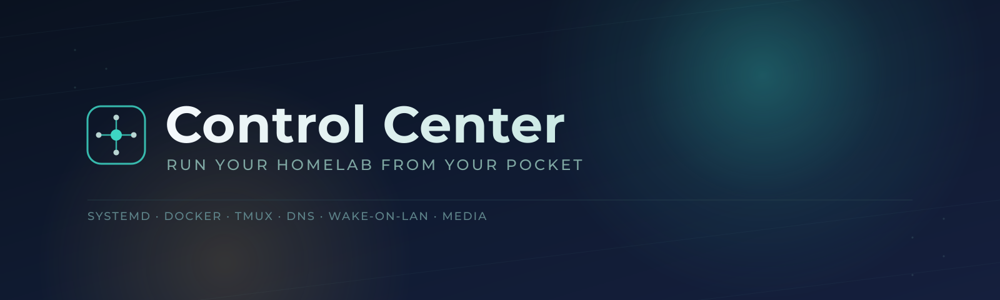

[](https://kotlinlang.org)
[](https://developer.android.com/jetpack/compose)
[](https://developer.android.com/tools/releases/platforms)
[](LICENSE)


A single-activity Android app that puts your home server in your pocket: services, containers, a terminal, vitals, wake-on-LAN, alerts, and your Jellyfin library, all in one place. It is a thin client for a small HTTP "bridge" that you run on your own machine. A reference bridge with demo data is included, so you can try the app without a server.

## Try it with the demo bridge

The demo bridge serves an invented homelab (machines, services, containers, logs, a fake terminal, a small made-up Jellyfin library with one generated test clip). It never runs a command or touches your system. You need [uv](https://docs.astral.sh/uv/).

```sh
uv run bridge/bridge.py --demo
```

It listens on `127.0.0.1:8790`. Then open the app and enter the bridge URL on the first-run setup card:

- **Android emulator:** `http://10.0.2.2:8790`
- **Phone on the same network:** start the bridge with `--host 0.0.0.0` and use `http://<your computer's LAN address>:8790`.

The bridge has no authentication. Anyone who can reach the port can use it, so keep it on localhost, a private network, or a tailnet, never the open internet. Details, options, and the full API contract are in [bridge/README.md](bridge/README.md).

## Screenshots

All screenshots are taken against the demo bridge.

| | | |
|---|---|---|
| 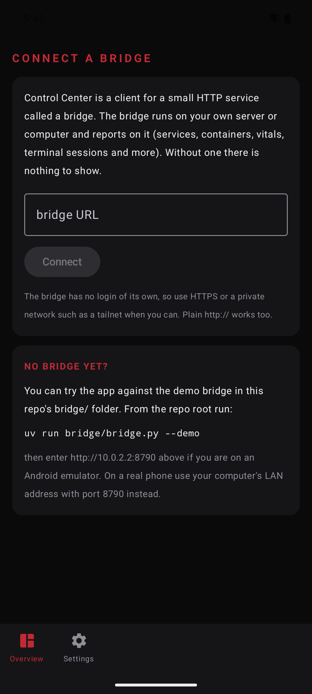 | 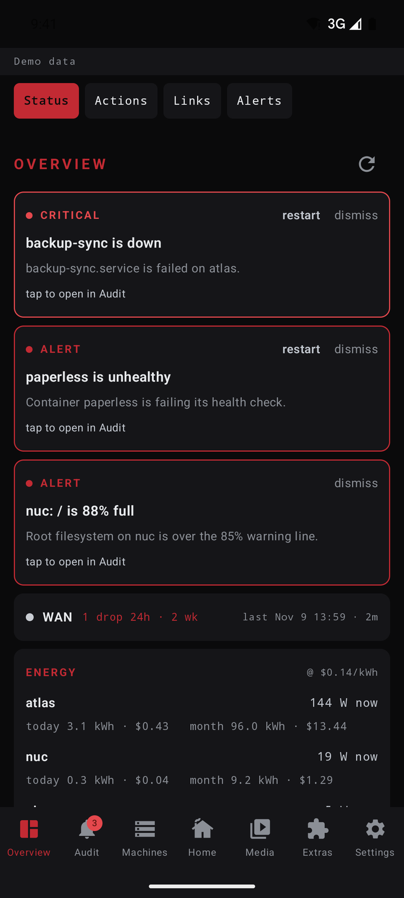 | 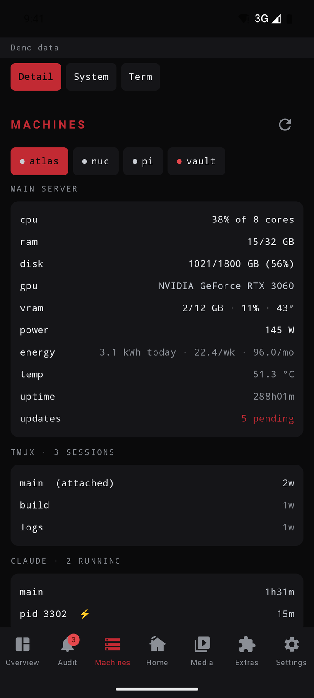 |
| 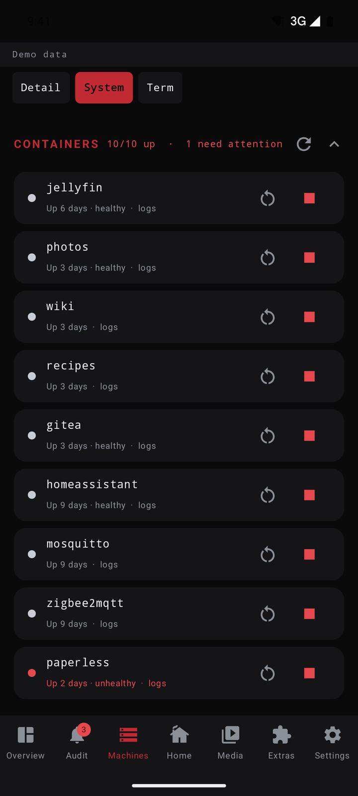 | 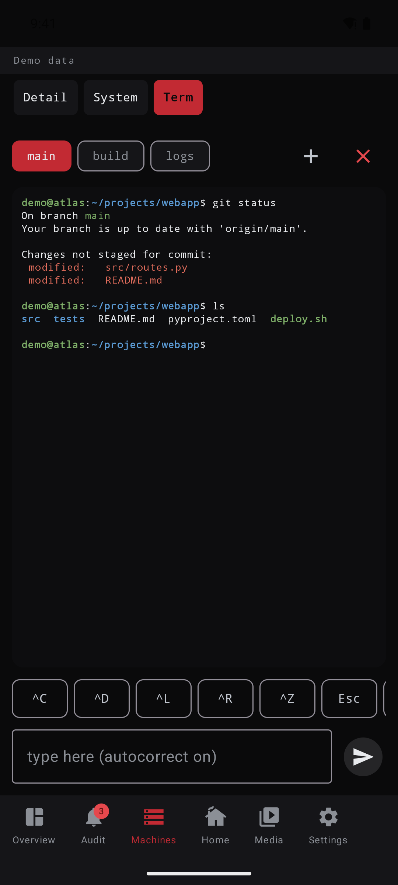 | 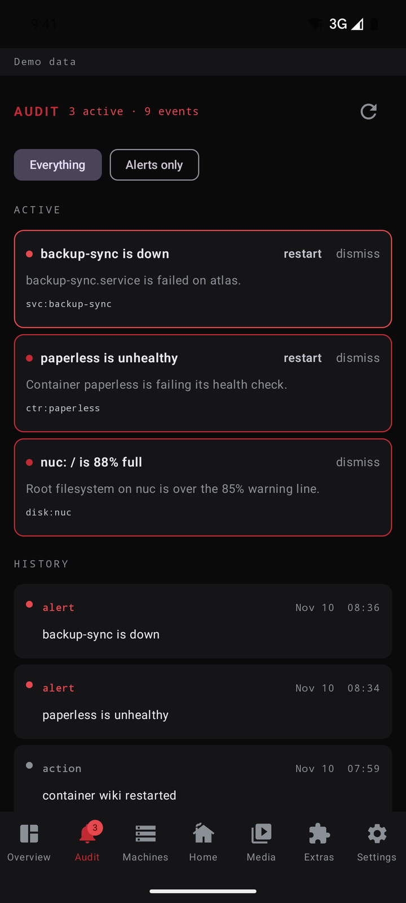 |
| 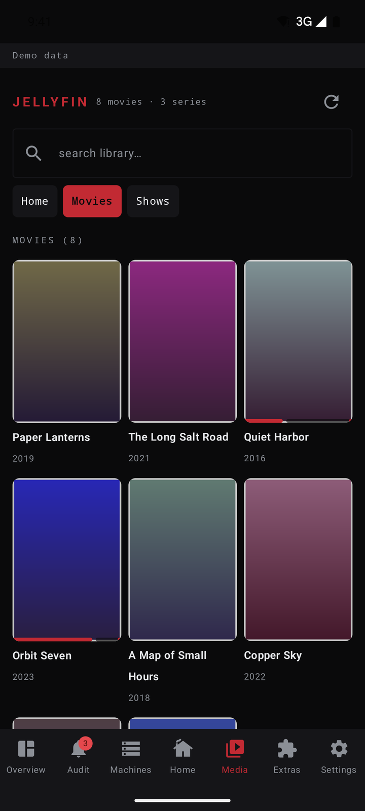 | 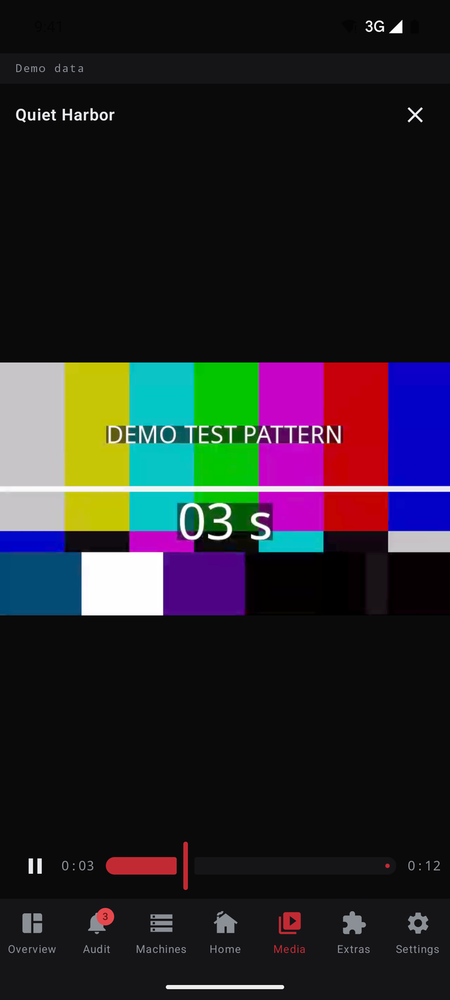 | 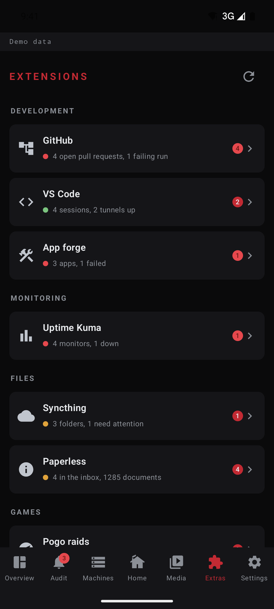 |
| 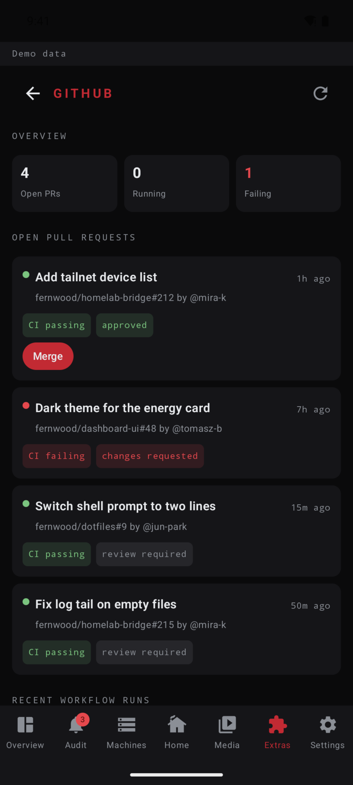 | 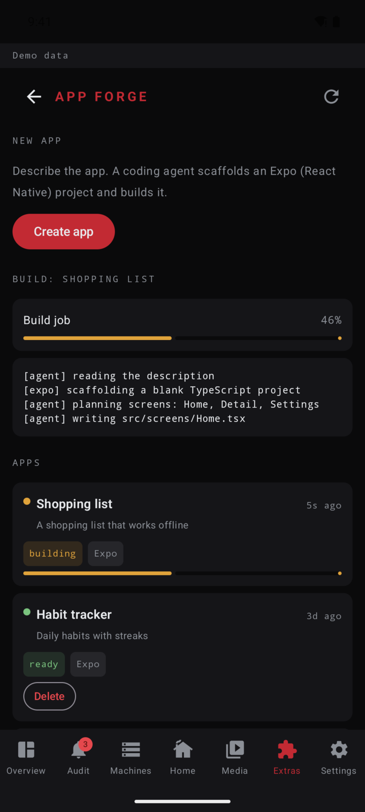 | |

## Features

The bottom bar has six tabs plus Settings. Tabs and panes the bridge does not offer are hidden (see "Capabilities handshake" below).

- **Overview**: Status (alerts you can restart or dismiss, WAN line status with drop history, energy use and cost per machine, a per-machine summary, DNS filter stats), Actions (bridge-defined quick actions, plus a flashlight and vibrate test), Links (every web UI on your network in one tappable list, fetched from the bridge), and Alerts.
- **Audit**: active alerts with restart and acknowledge, and the bridge's full event log.
- **Machines**: Detail (per-box CPU, RAM, disk, GPU, temperature, power draw and energy; for the bridge's own host also tmux sessions, coding-agent sessions, services and DNS filter stats), System (GPU and host gauges, power draw, quick actions, weekly token usage per coding-agent source, systemd services and Docker containers with start/stop/restart and logs, backup status with a run button, tailnet devices, and per-machine power controls including wake), and Term (a tmux mirror with ANSI colors, create/kill sessions, control keys, auto-resize to phone width).
- **Home**: a curated list of entities from your home automation setup with toggles and open/close buttons, defined bridge-side, plus a Zigbee pairing toggle.
- **Media**: browse your own Jellyfin library (a poster grid per library, search, item details with runtime and played state, what is streaming right now) and play items on the phone in a small built-in player with play/pause and a seek bar. In demo mode every item plays a generated test clip. An embedded file browser pane appears next to it once its URL is set in Settings.
- **Extras**: integrations the bridge describes and the app draws, see "Extensions" below. The demo bridge ships seventeen, listed under group headers.
- **Settings**: bridge URL, file browser URL, wake relay, bridge host machine name, power cost settings, and a viewer for the last crash report.
- **Wake-on-LAN** from the Overview and from Machines > System, plus a home-screen Quick Settings tile that wakes your host through a small always-on relay, so it works even when the bridge (and the box it lives on) is off.
- **Home-screen widget**: stack health (services, containers, disk) refreshed by WorkManager every 30 minutes.
- **Self-update**: opt-in and off by default. When switched on, and when the bridge advertises an update manifest, a background worker can fetch and install new versions of the app.


## Tech stack

- Kotlin, Jetpack Compose (Material 3), single `MainActivity`
- OkHttp for networking, `org.json` for parsing (no Retrofit, no Room, deliberately few dependencies)
- WorkManager for background refresh and auto-update
- Android `PackageInstaller` API for silent app updates
- Quick Settings Tile API, App Widget API

## Architecture overview

The app is a thin client. Almost everything it shows comes from a small HTTP bridge running on your server; Control Center itself holds no business logic beyond rendering and light client-side state.

- **Single activity, tabbed navigation.** `MainActivity` hosts a bottom bar (Overview, Audit, Machines, Home, Media, Extras, Settings); each is a top-level `@Composable` in its own file, with sub-panes inside Overview, Machines and Media.
- **Networking (`Api` object in `MainActivity.kt`)**: one OkHttp client, `Api.baseUrl` plus a relative path for every call, JSON in and out. The Jellyfin library, its posters and its video streams all come through the bridge's `/jellyfin/*` routes, so the phone only needs the one address. The player (`Player.kt`) is the platform `VideoView` and adds no library.
- **Config (`AppCfg` in `Settings.kt`)**: every endpoint and tunable is a `SharedPreferences`-backed var, loaded explicitly in `MainActivity.onCreate` and again at the top of every background entry point (widget worker, Quick Settings tile, auto-update worker), because those can run in a cold process where `onCreate` never fired.
- **Background work**: a WorkManager periodic job refreshes the home-screen widget every 30 minutes; a separate periodic job (15-minute floor) checks for and installs updates, and also drains the bridge's command queue for push-style notifications.
- **Updater (`Updater.kt`)**: downloads an APK, verifies size/sha256 against the manifest, and installs through `PackageInstaller`, silent once Control Center is the installer of record for a package (with a one-time "tap to finish" fallback via `InstallReceiver` otherwise).
- **Quick Settings tile (`WakeTile`)**: wakes your host through the wake relay directly, bypassing the bridge on purpose, since the bridge is what's down when the box is off.

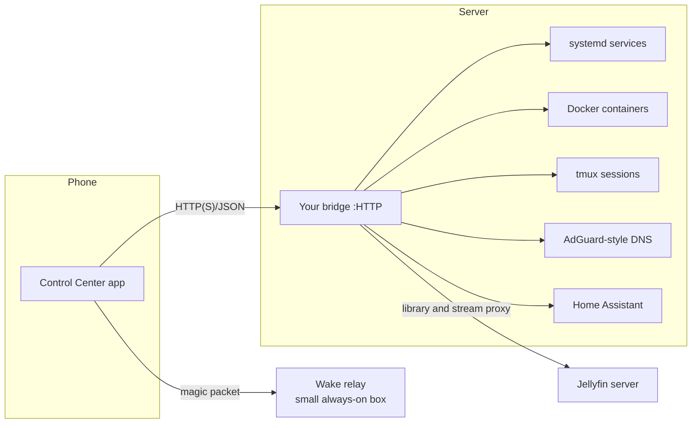

## The bridge

Control Center does not ship a backend of its own. It is a client for whatever HTTP bridge you point it at; the base URL is set in Settings (or on the first-run setup card). `bridge/bridge.py` is a single-file reference implementation with a demo mode, and [bridge/README.md](bridge/README.md) holds the API contract: every endpoint the app calls, the JSON fields it reads, and which ones are required. Use it if you want to write your own bridge.

### Extensions

An extension is an integration the bridge describes and the app renders with one generic screen, so adding one needs a bridge change and no new APK. The bridge lists them at `GET /extensions`, serves each one as sections of typed blocks (stats, list, progress, text, chips, actions, link) at `GET /extensions/{id}`, and takes button presses at `POST /extensions/{id}/action`. The app refreshes the open screen on the pace the bridge asks for. Unknown block types and fields are ignored, so a newer bridge does not break an older app.

The demo bridge serves seventeen, all with invented data (`--extensions github,hello` picks which). The list shows them under group headers, which come from an optional `group` field in `GET /extensions`; a bridge that sends none gets a flat list.

- **Development**: **GitHub** (pull requests, CI runs, merge and re-run), **VS Code** (remote sessions and tunnels), **App forge** (describe an app and watch a fake build job; in demo mode nothing is built, a real version would scaffold an Expo project and build it with a coding agent).
- **Agents**: a workflow for handing tasks to coding agents and reviewing their work. Demo views with invented data; no agent runs. **Agent board** (tasks per agent with question, proposal and result kinds; reply, approve a proposal, close), **Sessions** (running agent sessions with a context usage bar; hand off to a fresh session, stop), **Helm** (a project board with milestones, advance, add a note) and **Vibe** (describe a change, approve the plan, watch the work log, get a pull request and run a test build).
- **Monitoring**: **Uptime Kuma** (monitors with response times and 24 hour uptime, pause and resume).
- **Network**: **Pi-hole** (DNS filtering stats, pause for a short while, enable or disable, add a domain to the blocklist) and **WireGuard** (VPN peers with handshake age and transfer, enable, disable, remove, add a peer).
- **Raspberry Pi**: **Raspberry Pi** (temperature, uptime and throttling flags, SD card, interface toggles, boot and overclock settings, firmware update, reboot).
- **Files**: **Syncthing** (folder sync state with a moving progress bar, rescan) and **Paperless** (document inbox, a consume queue, mark reviewed).
- **Apps**: **Managed apps** (a demo view of small invented apps the phone keeps current from the bridge: versions, sizes, update with progress, check for updates).
- **Games**: **Pogo raids** (sample raid bosses and events with made-up dates; a real version would read a public community event feed) and **Deadlock** (a draft-advisor overlay switch, suggested picks, recent matches, all sample numbers).
- **Examples**: **Hello**, the 20-line example.

The homelab apps (Uptime Kuma, Syncthing, Paperless, Pi-hole, WireGuard and the Pi panel) are demo views with invented titles, users and numbers. A real bridge would call each app's own API (Pi-hole's API, the `wg` tool, the Pi's configuration tool) and return the same blocks.

| | | |
|---|---|---|
| 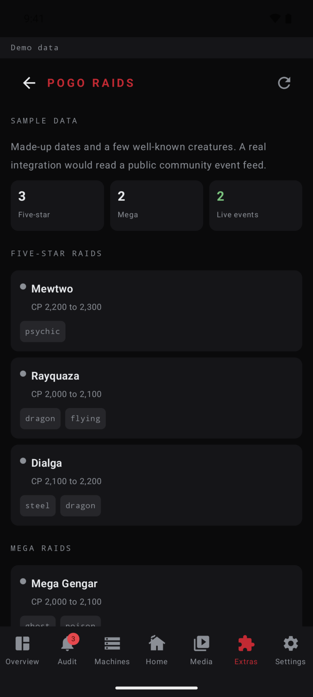 | 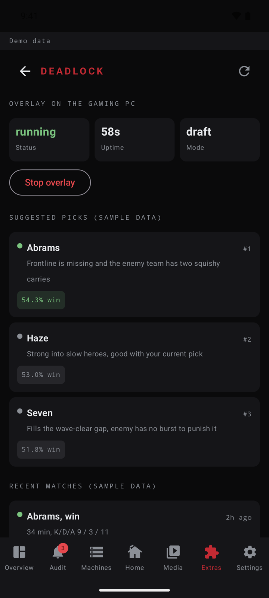 | 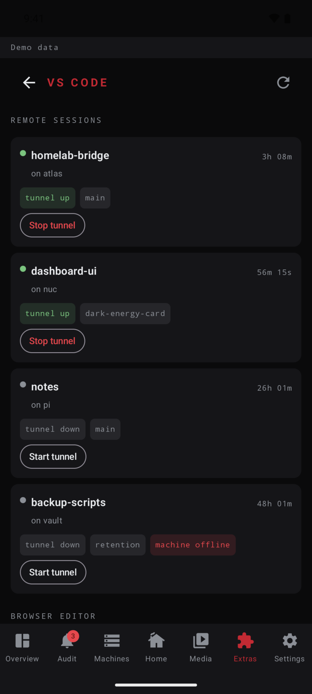 |
| 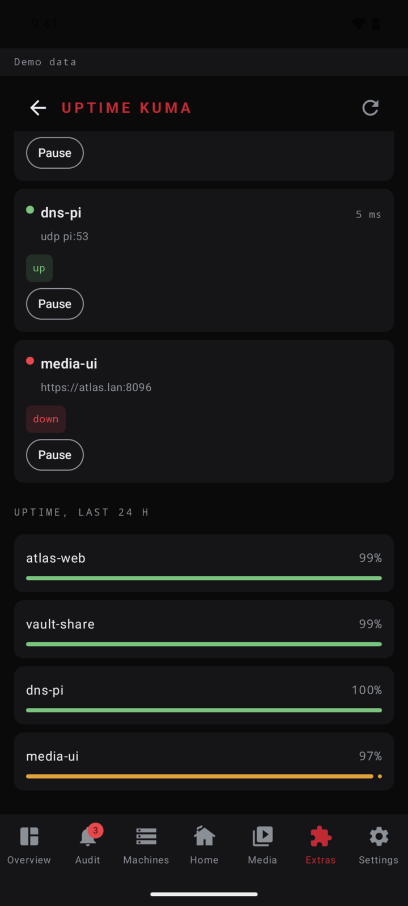 | 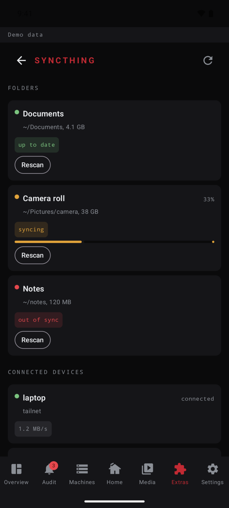 | 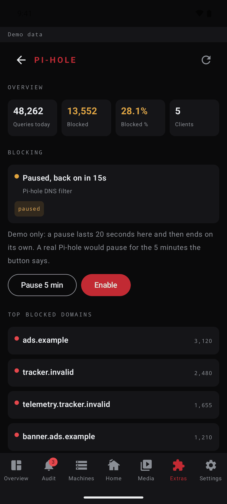 |
| 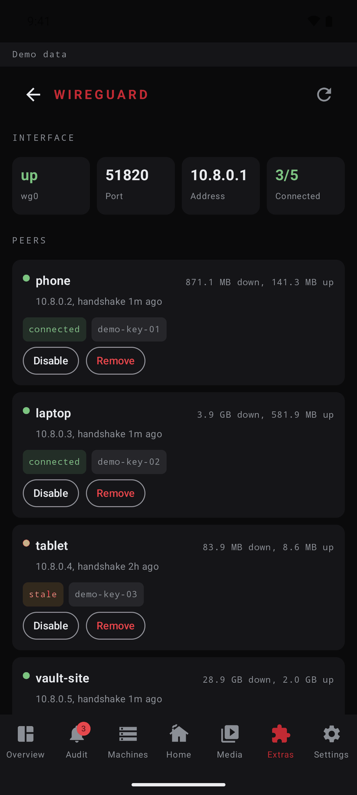 | 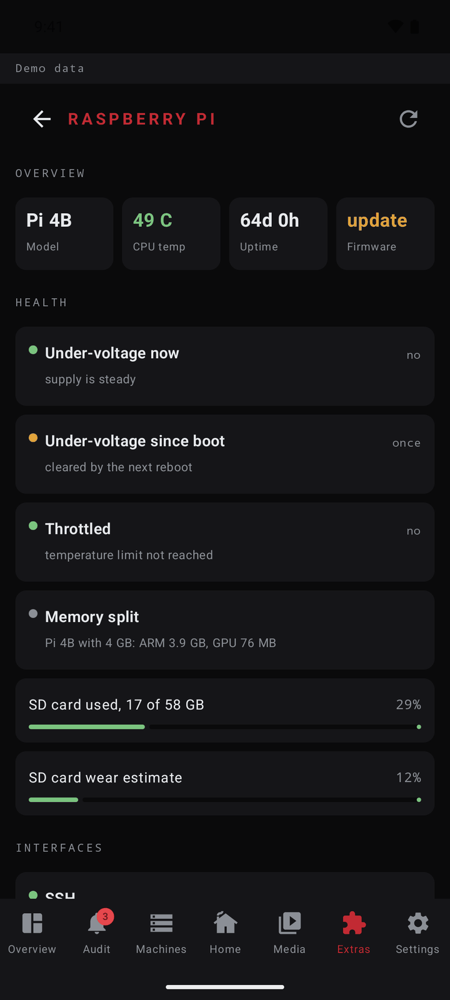 | |

The block table and a "write your own" walkthrough are in [bridge/README.md](bridge/README.md#extensions).

### Capabilities handshake

After the bridge URL is set, the app calls `GET /capabilities`, which returns `{"version": 1, "demo": bool, "features": [...]}`. Tabs, panes and cards whose feature is not in the list are hidden instead of showing errors, so a small bridge that only serves services and vitals gives a small app. If the endpoint is missing (an older bridge), the app falls back to showing everything, except the Extras tab, which needs the `extensions` feature to be advertised. The feature names are: `services, containers, vitals, gpu, machines, terminal, tmux_overview, claude_sessions, wake, alerts, events, links, adguard, home, zigbee, jellyfin, backup, usage, power_draw, updates, wan, actions, tailnet, commands, updater, extensions`. When `demo` is true, a "Demo data" strip is shown at the top.


## Build

Requires JDK 17 or 21 (AGP 8.7.3 doesn't yet support newer JDKs) and the Android SDK.

```sh
./gradlew assembleDebug
```

Set `ANDROID_HOME` (or an SDK path in `local.properties`) if Gradle can't find the SDK. Release builds (`./gradlew assembleRelease`) work out of the box, signed with your debug keystore, unless you provide real signing credentials (see below).

## Configure it for your own server

1. Optionally copy `config.example.properties` to `config.properties` (gitignored) and fill in build-time values: a trigger token for the update-trigger receiver, a default bridge URL, and/or release signing credentials.
2. Build and install the app. With no bridge URL set, it shows a setup card. Enter your bridge URL there, then open **Settings** to fill in whatever else you use:
   - **files URL**: a filebrowser instance (blank hides the Files pane)
   - **wake relay URL** and **wakeable machine name**: for waking a box from fully off
   - **bridge host machine name**: which machine's tmux sessions, coding sessions, services and DNS stats to show in Machines > Detail
   - **baseline watts** and **$/kWh**: for the software power and cost estimate

Everything except the bridge URL is optional and blank by default; features tied to an unset field just do not show anything.

Plain `http://` URLs are allowed, so a LAN address or an emulator address works without a certificate. HTTPS or a private network (Tailscale, WireGuard, plain LAN) is still recommended. The app does not add authentication, and the demo bridge has none, so put your own in front of a bridge you expose more widely.


## Why I built it

This is the public edition of an app I use daily to run my home server from my phone: check on services, restart something that fell over, pull up a log, or wake a box that's asleep, all without opening a laptop. The private build I actually run has a few more integrations specific to my own setup; this version keeps everything generic and configurable so it's useful as a starting point for anyone running their own small homelab bridge.

## License

MIT. See [LICENSE](LICENSE).
